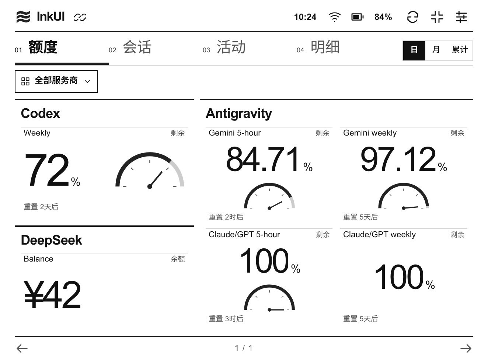
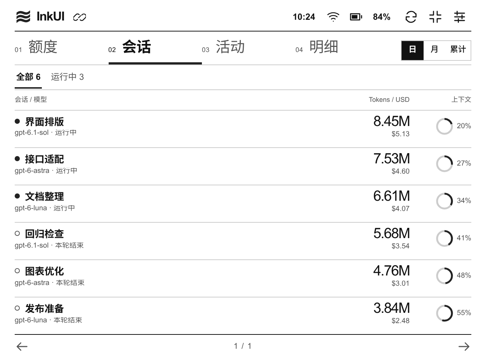
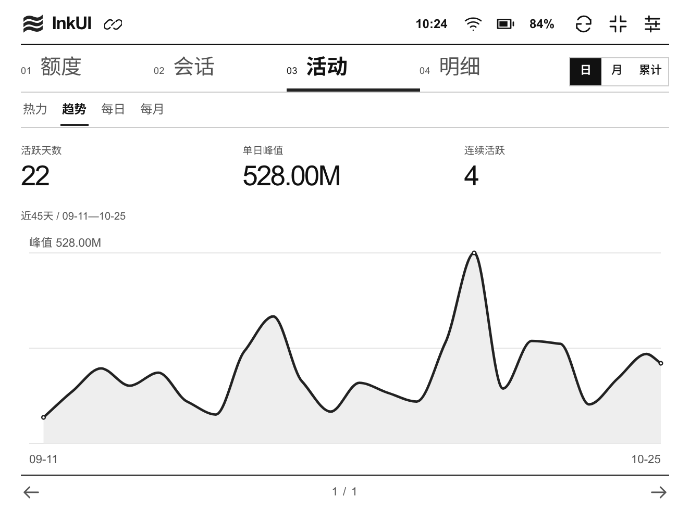
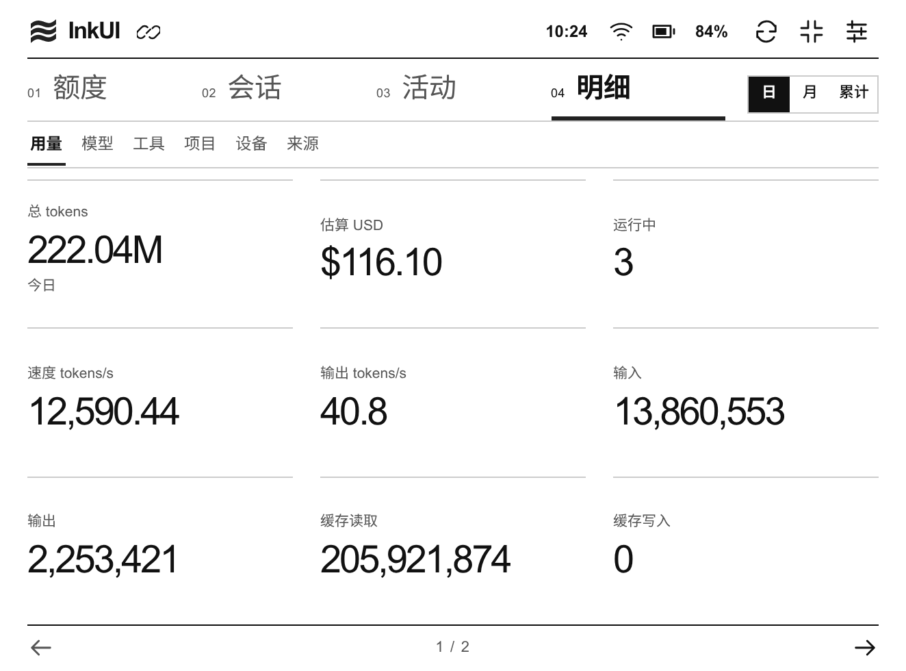
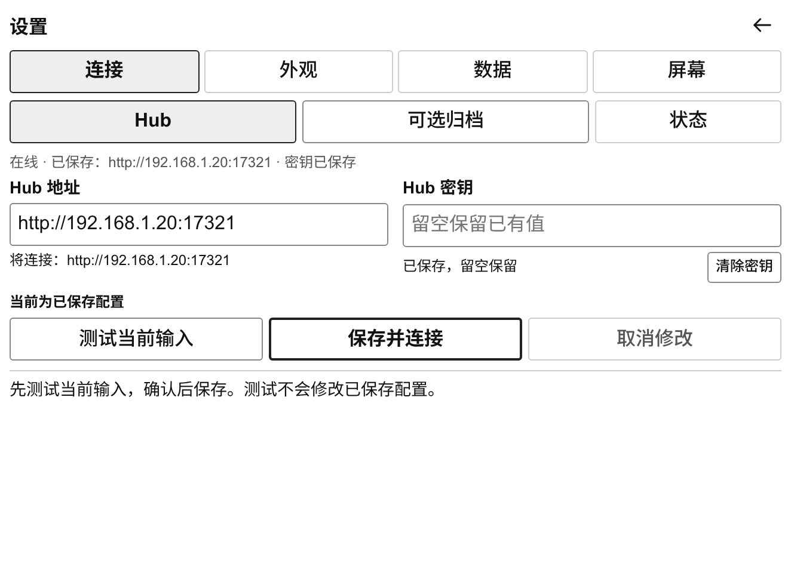
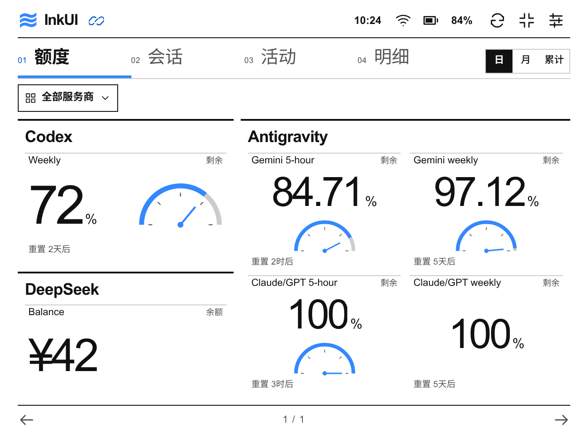

# InkUI for Token-Monitor

面向墨水屏的 [Token Monitor](https://github.com/Javis603/token-monitor) Android 客户端。把电脑上的 AI 工具用量、额度和活动放到独立屏幕上，当前主要适配 BOOX Poke3，支持 Android 10 及以上。

这是独立开发的非官方客户端，并非 Token Monitor 的完整 fork。账号登录、数据采集与跨设备汇总由你另行运行的 Token Monitor Hub 提供；InkUI 负责读取和展示。

[下载最新 APK](https://github.com/Shangshui0302/InkUI-for-Token-Monitor/releases/latest) · [Android 指南](docs/token-monitor-android.md) · [反馈问题](https://github.com/Shangshui0302/InkUI-for-Token-Monitor/issues)

## 界面预览

以下为按 Poke3 横屏比例渲染的界面截图，使用合成演示数据，不是真机实拍，也不含真实账号数据。

| 额度 | 会话 |
| --- | --- |
|  |  |
| **活动** | **明细** |
|  |  |

| 设置 | 亮色模式 |
| --- | --- |
|  |  |

## 安装与连接

1. 在电脑上安装并运行 [Token Monitor](https://github.com/Javis603/token-monitor)，启用 Hub，确保 Android 设备可通过局域网访问它。额度适配以 **Token Monitor v0.78.0 的全部 30 家服务商**为基线。
2. 从 [Releases](https://github.com/Shangshui0302/InkUI-for-Token-Monitor/releases/latest) 下载 `InkUI-for-Token-Monitor-v1.2.0.apk`，传到设备安装。发布页提供 `SHA256SUMS` 供校验。
3. 首次打开，在“连接”中填写电脑的 Hub 地址，例如 `http://192.168.1.20:17321`，以及 Hub 密钥。
4. 点击“测试当前输入”，成功后点击“保存并连接”。之后即可通过顶部导航进入额度、会话、活动和明细。

左右轻扫可在抬手后翻页，也可使用翻页按钮。点击额度、余额或用量条目查看完整字段；设置中可切换配色与刷新频率，顶栏按钮可切换全屏模式。Poke3 可在“设置 → 屏幕”手动清屏。

Release 包名保留 `dev.tokenmonitor.eink`，使用相同签名可覆盖升级并保留配置。若 Poke3 安装后无法打开，先检查设备是否冻结了应用。连接失败、旧 Hub 的字段限制与签名说明见 [Android 指南](docs/token-monitor-android.md)。

Hub 原密钥也可授权写接口，InkUI 只发送固定 GET 请求；HTTP 连接不加密，请在可信网络使用，或自行提供 HTTPS／只读认证入口。

## 主要特性

- **四页固定视口**：额度、会话、活动、明细，无滚动、无动画；按钮分页与抬手翻页，完整信息通过详情分页读取。
- **适合墨水屏的显示**：黑白模式采用 16 阶灰度，另有蓝、青、绿、琥珀、玫瑰、紫六种亮色重点色；额度卡片按账号信息量分配空间。
- **保留数据语义**：支持百分比、金额、点数、次数、Token 池、消费额、不限额、重置券和分批到期余额，区分零值、未知、过期与读取失败。完整范围见 [Provider 覆盖表](docs/token-monitor-android.md#provider-额度覆盖)。
- **活动与用量**：日／月／累计视图、热力图、平滑趋势与分项分布；历史按真实日期间距显示，不把缺失记录补成零。费用为估算值。
- **设备状态与离线提示**：显示本地时间、电量／充电、网络链路与独立 Hub 状态；保留最近成功的展示数据，断线时明确标记缓存。
- **Poke3 刷新适配**：GC16 局部更新，每 6 次翻页或累计 30 次局部更新后全刷；切换配色、恢复前台和手动清屏可请求全刷。其他设备由系统管理刷新，实体彩屏与其他机型刷新波形尚未实测。

本项目只连接 Hub，以及可选的已有会话归档服务。直接登录或查询各服务商 API 尚不支持。

## 开发

需要已有 JDK 17+、Android SDK platform 36 和匹配的 build-tools：

```bash
export JAVA_HOME=/path/to/jdk
export ANDROID_HOME=/path/to/android-sdk
tools/build-eink-apk.sh debug
```

输出 `output/android/inkui-debug.apk`。Release 的私有签名配置与构建方式见 [构建与签名升级](docs/token-monitor-android.md#构建与签名升级)。

```bash
node --test apps/android/ui/test_*.mjs
node --check apps/android/ui/app.js
apps/android/gradlew -p apps/android :app:checkNativePolicy :app:checkConnectionTest :app:checkDisplayRefresh :app:checkDeviceStatus
```

| 路径 | 内容 |
| --- | --- |
| `apps/android/` | Android 工程与原生连接、设备和刷新适配 |
| `apps/android/ui/` | 包内界面、数据模型、合成夹具与测试 |
| `tools/build-eink-apk.sh` | APK 构建入口 |
| `docs/` | Android 使用与开发指南、演示截图 |
| `assets/cats/` | 保留供以后复用的猫猫设计资产 |

验证范围及真机边界见 [当前验证范围](docs/token-monitor-android.md#当前验证范围)。构建成功、浏览器模拟与真机测试分别记录。

## 致谢与许可

感谢 [Javis603/token-monitor](https://github.com/Javis603/token-monitor) 提供 Hub 与数据采集能力；上游采用 MIT 许可证。InkUI 的接口适配以其公开协议和源码为依据，双方无官方隶属关系。

本仓库前身为 nekodex，现已聚焦 Android APK，不再维护旧桌面客户端或后端。原创代码采用 [MIT 许可证](LICENSE)，第三方构建工具见 [许可声明](THIRD_PARTY_NOTICES.md)；保留的参考图与猫猫资产说明见 [assets/cats/README.md](assets/cats/README.md)，不将其一并宣称为 MIT 授权。
