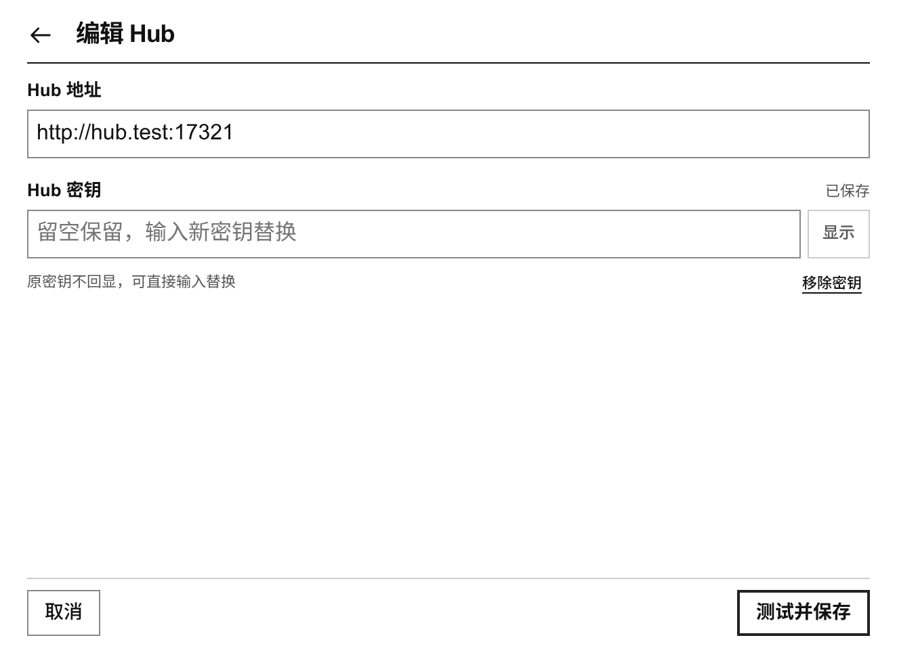
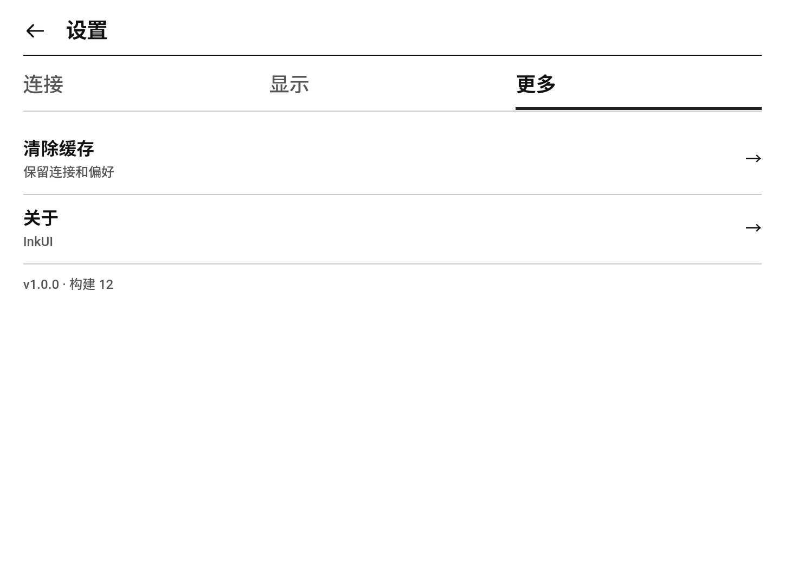
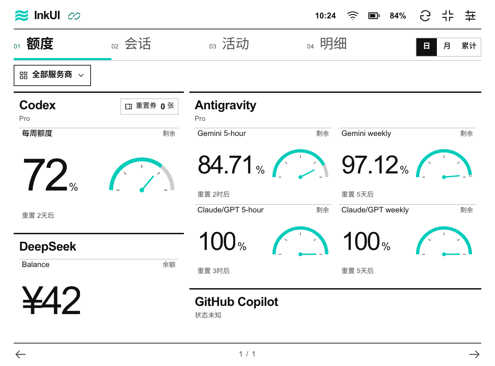
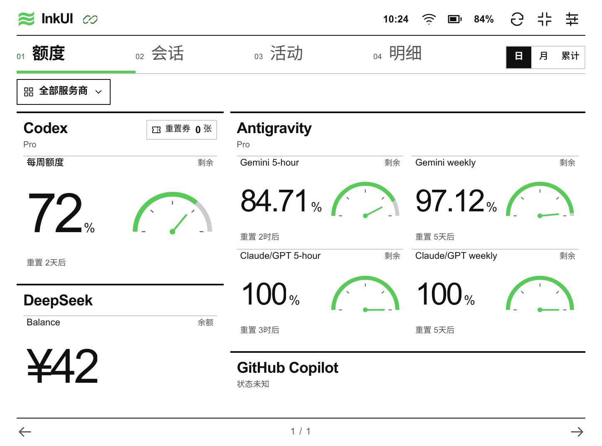
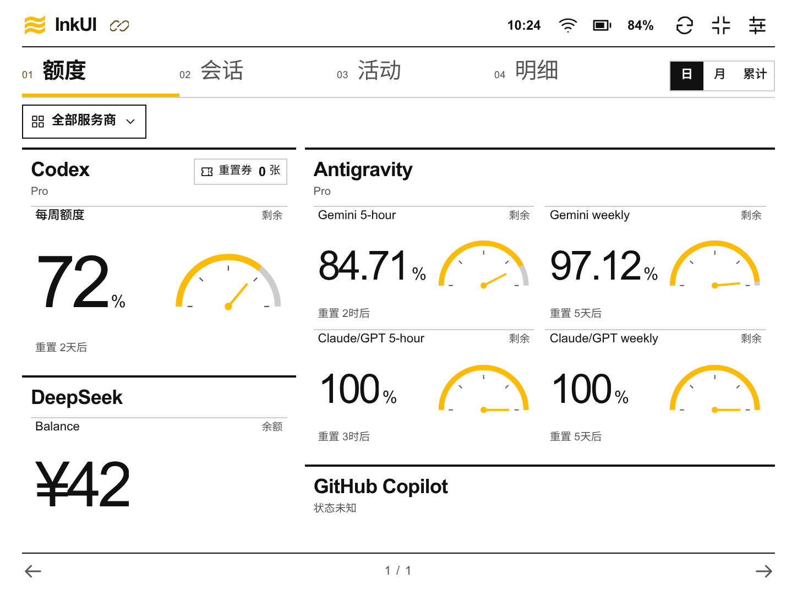
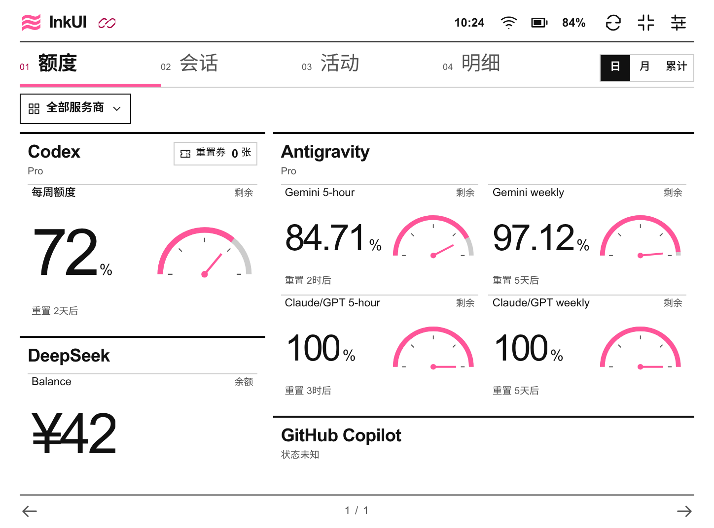
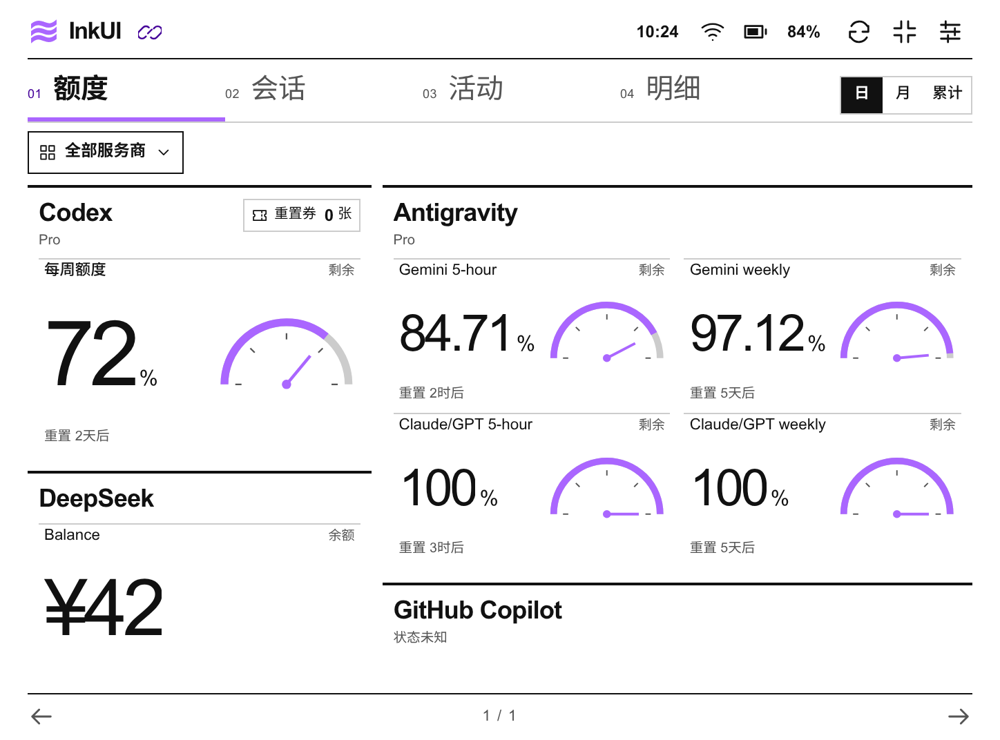

# InkUI for Token-Monitor

面向墨水屏的 [Token Monitor](https://github.com/Javis603/token-monitor) Android 客户端。把电脑上的 AI 工具用量、额度和活动放到独立屏幕上，当前主要适配 BOOX Poke3，支持 Android 10 及以上。

这是独立开发的非官方客户端，并非 Token Monitor 的完整 fork。账号登录、数据采集与跨设备汇总由你另行运行的 Token Monitor Hub 提供；InkUI 负责读取和展示。

[下载最新 APK](https://github.com/Shangshui0302/InkUI-for-Token-Monitor/releases/latest) · [更新日志](docs/token-monitor-android.md#更新日志) · [Android 指南](docs/token-monitor-android.md) · [反馈问题](https://github.com/Shangshui0302/InkUI-for-Token-Monitor/issues)

## 界面预览

黑白额度页和设置的“更多”页为 Poke3 真机截图，其余预览使用合成数据。六种亮色配色均展示相同数据和尺寸的额度页，为浏览器渲染，不代表实体彩屏实测。

| 额度 | 会话 |
| --- | --- |
|  |  |
| **活动** | **明细** |
|  |  |

### 设置预览

设置按连接、显示、更多分组；连接和显示使用合成数据，“更多”为 Poke3 真机截图。公开安装包以发布页为准。

| 连接 | 显示 | 更多 |
| --- | --- | --- |
|  |  |  |

### 亮色配色预览

| 蓝 | 青 |
| --- | --- |
|  |  |
| **绿** | **琥珀** |
|  |  |
| **玫瑰** | **紫** |
|  |  |

## 安装与连接

1. 在电脑上安装并运行 [Token Monitor](https://github.com/Javis603/token-monitor)，启用 Hub，确保 Android 设备可通过局域网访问它。额度适配以 **Token Monitor v0.78.0 的全部 30 家服务商**为基线。
2. 从 [Releases](https://github.com/Shangshui0302/InkUI-for-Token-Monitor/releases/latest) 下载 APK，传到设备安装。发布页提供 `SHA256SUMS` 供校验。
3. 首次打开直接填写电脑的 Hub 地址，例如 `http://192.168.1.20:17321`，以及 Hub 密钥。
4. 点击“连接并保存”，验证成功后自动保存并进入额度页。之后即可通过顶部导航进入额度、会话、活动和明细。

左右轻扫可在抬手后翻页，也可使用翻页按钮。点击额度、余额或用量条目查看完整字段；设置中可切换配色与刷新频率，顶栏按钮可切换全屏模式。Poke3 可在“设置 → 显示”手动清屏。

已保存的 Hub 地址与密钥会保留，换网或重启应用无需重填；网络恢复后自动尝试连接。可使用局域网 DNS 能解析的主机名；Hub 目前没有自动发现，IP 改变且主机名不可解析时仍需编辑地址。详见 [连接恢复说明](docs/token-monitor-android.md#连接记忆与断线恢复)。

Release 包名保留 `dev.tokenmonitor.eink`，使用相同签名可覆盖升级并保留配置。若 Poke3 安装后无法打开，先检查设备是否冻结了应用。连接失败、旧 Hub 的字段限制与签名说明见 [Android 指南](docs/token-monitor-android.md)。

Hub 原密钥也可授权写接口，InkUI 只发送固定 GET 请求；HTTP 连接不加密，请在可信网络使用，或自行提供 HTTPS／只读认证入口。

## 主要特性

- **四页固定视口**：额度、会话、活动、明细，无滚动、无动画；按钮分页与抬手翻页，完整信息通过详情分页读取。
- **适合墨水屏的显示**：黑白模式采用 16 阶灰度，另有蓝、青、绿、琥珀、玫瑰、紫六种亮色重点色；额度卡片按账号信息量分配空间。
- **自定义服务商顺序**：在“全部服务商”的选择面板进入排序，用置顶、上移、下移调整账号卡片；按钮分页，保存后应用于卡片和选择列表，并按 Hub 分开保留。
- **保留数据语义**：支持百分比、金额、点数、次数、Token 池、消费额、不限额、重置券和分批到期余额，区分零值、未知、过期与读取失败。完整范围见 [Provider 覆盖表](docs/token-monitor-android.md#provider-额度覆盖)。
- **活动与用量**：日／月／累计视图、热力图、平滑趋势与分项分布；历史按真实日期间距显示，不把缺失记录补成零。费用为估算值。
- **设备状态与离线提示**：显示本地时间、电量／充电、网络链路与独立 Hub 状态；保留最近成功的展示数据，断线时明确标记缓存。
- **断线恢复**：记住连接，回网后合并重连；临时失败逐步降低重试频率，认证或接口错误等待手动处理，手动更新模式不定时重试。
- **Poke3 刷新适配**：GC16 局部更新，每 6 次翻页或累计 30 次局部更新后全刷；切换配色、恢复前台和手动清屏可请求全刷。其他设备由系统管理刷新，实体彩屏与其他机型刷新波形尚未实测。

本项目只读取 Token Monitor Hub 提供的数据。直接登录或查询各服务商 API 尚不支持。

## 版本规则

首个公开版本为 **1.0.0**。后续按 `主版本.次版本.修订版本` 递增：不兼容变更增加主版本，兼容新增功能增加次版本，修复与局部优化增加修订版本；增加高位时低位归零。开发包使用目标版本加 `-dev`，Android 内部构建号独立递增。当前源码版本为 **1.0.2（构建 16）**；可安装的正式包以 GitHub Release 为准。正式标签触发 CI，全部检查通过后签名并发布安装包和校验文件。详见 [版本号](docs/token-monitor-android.md#版本号)。

## 开发

需要已有 JDK 17+、Android SDK platform 36 和匹配的 build-tools：

```bash
export JAVA_HOME=/path/to/jdk
export ANDROID_HOME=/path/to/android-sdk
tools/build-eink-apk.sh debug
```

输出 `output/android/inkui-<version>-code<code>-debug.apk` 及校验文件。Release 的私有签名配置与构建方式见 [构建与签名升级](docs/token-monitor-android.md#构建与签名升级)。

```bash
apps/android/gradlew -p apps/android :app:checkEink :app:lintDebug
# 连接独立调试设备／模拟器，运行真实 Android 框架检查
apps/android/gradlew -p apps/android :app:connectedDebugAndroidTest
```

| 路径 | 内容 |
| --- | --- |
| `apps/android/` | Android 工程与原生连接、设备和刷新适配 |
| `apps/android/ui/` | 包内界面、数据模型、合成夹具与测试 |
| `tools/build-eink-apk.sh` | 包含完整检查的 APK 构建入口 |
| `tools/verify-eink-release.sh` | APK 版本、签名、资源和发布一致性检查 |
| `docs/` | Android 使用与开发指南、演示截图 |
| `assets/cats/` | 保留供以后复用的猫猫设计资产 |

`checkEink` 自动发现全部原生策略检查和界面测试；构建会执行同一门禁。CI 另在 Android API 29／36 运行框架测试。发布校验读取 APK 内实际版本和资源，不只依赖文件名；正式发布要求匹配标签、前次内部构建号与长期签名指纹。

验证范围及真机边界见 [当前验证范围](docs/token-monitor-android.md#当前验证范围)。构建成功、浏览器模拟与真机测试分别记录。

## 致谢与许可

感谢 [Javis603/token-monitor](https://github.com/Javis603/token-monitor) 提供 Hub 与数据采集能力；上游采用 MIT 许可证。InkUI 的接口适配以其公开协议和源码为依据，双方无官方隶属关系。

本仓库前身为 nekodex，现已聚焦 Android APK，不再维护旧桌面客户端或后端。原创代码采用 [MIT 许可证](LICENSE)，第三方构建工具见 [许可声明](THIRD_PARTY_NOTICES.md)；保留的参考图与猫猫资产说明见 [assets/cats/README.md](assets/cats/README.md)，不将其一并宣称为 MIT 授权。
